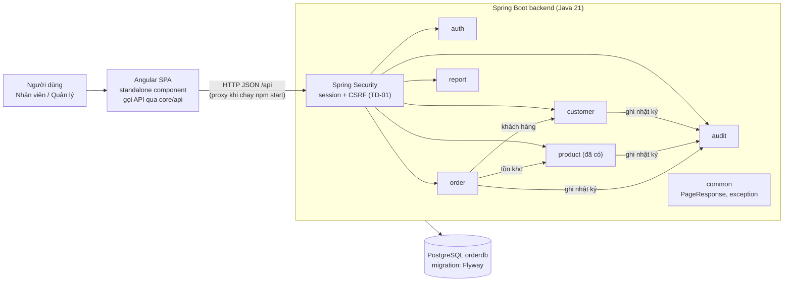
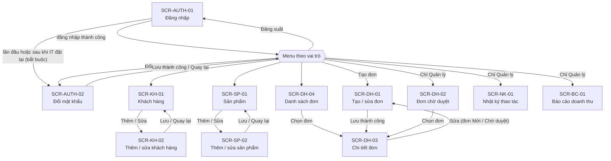
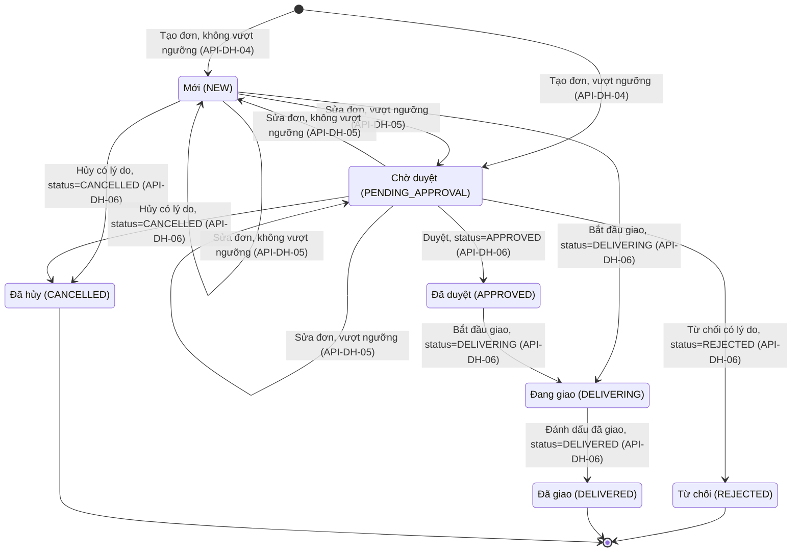
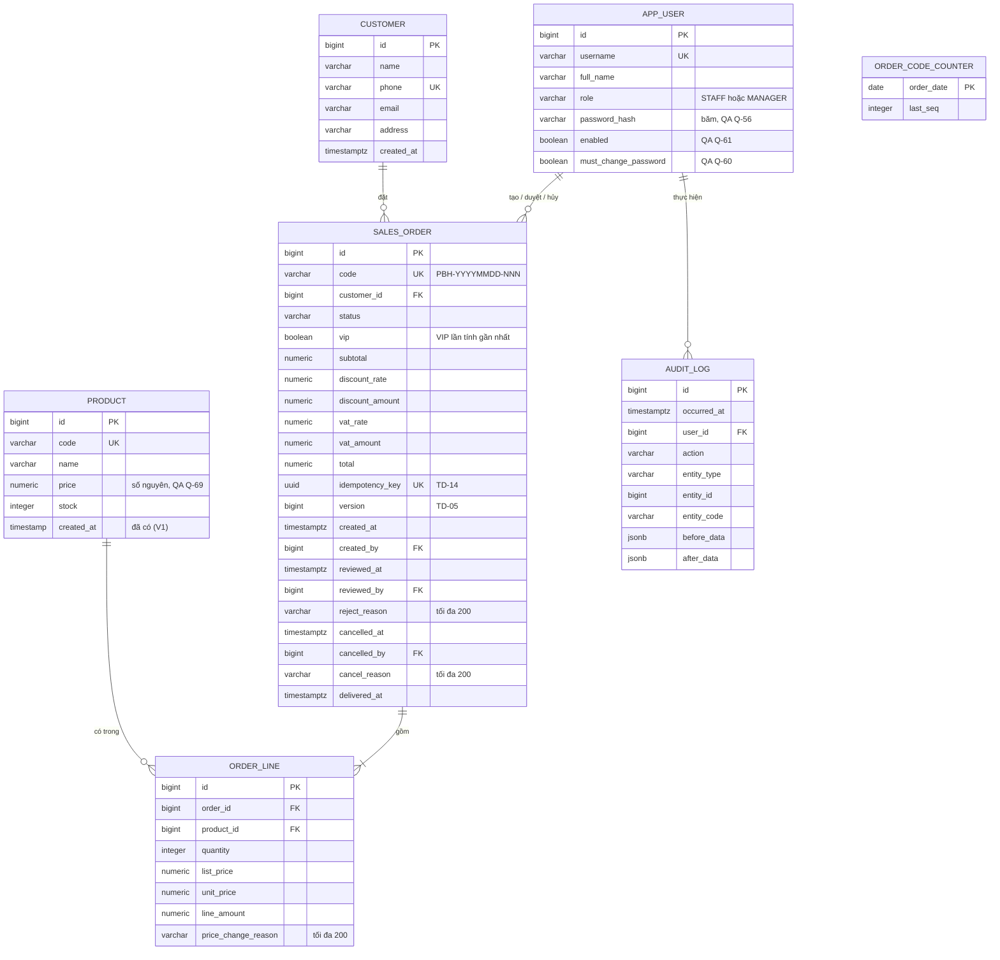

# Basic Design – Hệ thống quản lý đơn hàng
Phiên bản: 0.6 · Ngày: 2026-10-15 · Người viết: Dang Van Hoc

Lịch sử thay đổi:
- 0.1: bản đầu.
- 0.2: áp dụng câu trả lời Q-56 → Q-59. Thêm đổi mật khẩu (SCR-AUTH-02, API-AUTH-04); chốt nội dung báo cáo; loại phương án SSO ở TD-01. Mở Q-60 → Q-62.
- 0.3: áp dụng câu trả lời Q-60 → Q-64. Chính sách mật khẩu, bắt đổi mật khẩu lần đầu và sau khi IT đặt lại, vô hiệu hóa tài khoản có hiệu lực ngay (bảng `app_user` thêm 2 cột); tìm đơn theo SĐT khách; tìm tên khách phân biệt dấu; nhật ký có thêm loại đối tượng Tài khoản. Không còn câu hỏi mở.
- 0.4: theo spec đơn hàng v0.10 (câu trả lời Q-65 → Q-73). Đơn giá và giá sản phẩm là số nguyên ≥ 0 (bổ sung thay đổi cho chức năng sản phẩm); ngưỡng duyệt và ngưỡng VIP là tham số cấu hình; giá trị tính tiền lấy tại thời điểm lưu (DH BR-25); giảm giá VIP một lần trên tạm tính cả đơn, làm tròn half-up. Cập nhật TD-02, TD-08, TD-09, TD-10. Không còn câu hỏi mở.
- 0.5: theo spec đơn hàng v0.12 (câu trả lời Q-74, Q-75).
  - Mỗi TD còn đúng 2 phương án, bỏ dòng gợi ý. TL chọn phương án cho TD-03, TD-04, TD-06 → TD-11, TD-14 → TD-17 (duyệt kế hoạch 2026-10-15).
  - Thêm TD-14 → TD-17, sơ đồ trạng thái đơn (mục 4), cột "API dùng" cho màn hình (mục 3), mã lỗi 401/403/409 dùng chung (mục 5).
  - Thêm cột `sales_order.vip`, `sales_order.idempotency_key`; các cột lý do dài tối đa 200 ký tự (mục 6).
  - Thêm thứ tự khóa dùng chung cho các API đơn hàng (mục 8).
- 0.6: TL chọn TD-01 A, TD-02 A, TD-05 A, TD-12 B, TD-13 A (2026-10-15). Không còn TD chờ TL.
  - Gộp API-DH-06 → API-DH-10 thành một API `PATCH /api/orders/{id}` (API-DH-06), kèm bảng trạng thái đích (mục 5).
  - API-DH-12 chốt là `POST /api/orders/preview`; API-BC-02 xuất Excel bằng Apache POI.
  - Thêm cột `sales_order.version`; API sửa đơn và chuyển trạng thái gửi kèm `version`.
  - Thêm mã lỗi 403 `CSRF_TOKEN_INVALID`; bổ sung thay đổi code cho Spring Security và Apache POI.

## 0. Nguồn và quy ước truy vết

| Ký hiệu | Nguồn |
|---------|-------|
| DH UC-xx / DH BR-xx / DH SCR-xx | `docs/spec/don-hang.md` v0.12 (đơn hàng, nhật ký thao tác) |
| OM UC-xx / OM SCR-xx | `docs/spec/order-management.md` v0.1 (khách hàng, sản phẩm, báo cáo) |
| QA: Q-xx | Câu trả lời đã đóng trong `docs/spec/qa.md` |
| TD-xx | Điểm kỹ thuật TL chọn phương án (mục 10) |

`order-management.md` được viết trước khi khách trả lời Q&A và chưa được cập nhật. Với khách hàng, sản phẩm và báo cáo, tài liệu này lấy **câu trả lời Q&A làm chuẩn**:

| Chủ đề | Quy tắc áp dụng | Nguồn |
|--------|-----------------|-------|
| Vai trò | Nhân viên: quản lý khách hàng, sản phẩm, tạo/hủy đơn. Quản lý: quyền nhân viên + duyệt đơn + xem báo cáo | QA: Q-02 |
| Tài khoản | IT tạo tài khoản và gán vai trò bằng script khi triển khai; người dùng tự đổi mật khẩu; quên mật khẩu thì liên hệ IT; không có màn hình quản lý người dùng | QA: Q-56 |
| Mật khẩu | Tối thiểu 8 ký tự, có cả chữ và số; mật khẩu mới phải khác mật khẩu hiện tại; bắt buộc đổi ở lần đăng nhập đầu và sau khi IT đặt lại mật khẩu; đổi mật khẩu được ghi nhật ký, không lưu giá trị mật khẩu | QA: Q-60, Q-63 |
| Vô hiệu hóa tài khoản | IT vô hiệu hóa bằng script; tài khoản bị vô hiệu không đăng nhập được, phiên đang mở bị ngắt ở thao tác kế tiếp; dữ liệu cũ giữ nguyên; không tự khóa khi nhập sai | QA: Q-61, Q-64 |
| Thông tin khách hàng | Tên, SĐT bắt buộc; email, địa chỉ tùy chọn | QA: Q-03 |
| SĐT khách hàng | Không được trùng; di động VN 10 chữ số, bắt đầu bằng 0 | QA: Q-04 |
| Xóa khách hàng | Không cho xóa khách đã có đơn | QA: Q-05 |
| Tìm khách hàng | Một ô tìm chung tên/SĐT, chứa một phần, không phân biệt hoa thường; để trống thì hiện toàn bộ. Tìm theo tên **phải gõ đúng dấu** tiếng Việt | QA: Q-06, Q-62 |
| Tìm đơn theo khách | Trên danh sách đơn chỉ tìm theo SĐT khách (chứa một phần), không tìm theo tên | QA: Q-62; DH BR-22 |
| Sản phẩm | Giữ CRUD hiện có (mã duy nhất, không đổi mã); không cho xóa sản phẩm đã có trong đơn. Giá sản phẩm là **số nguyên đồng**, được bằng 0 (hàng tặng); code hiện cho nhập 2 chữ số lẻ nên phải sửa | QA: Q-21, Q-65, Q-69 |
| Doanh thu tháng | Tính trên đơn Đã giao, gán theo ngày giao, giá trị sau giảm giá; hiển thị cả hai cột: trước VAT và sau VAT | QA: Q-19, Q-57 |
| Báo cáo | Chọn khoảng từ tháng đến tháng, tối đa 12 tháng; có xuất Excel. Cột: Tháng, Số đơn đã giao, Doanh thu trước VAT, Doanh thu sau VAT; tháng không có doanh thu hiển thị 0; có dòng tổng cộng. Màn hình và file Excel cùng nội dung | QA: Q-20, Q-57, Q-58 |
| Danh sách | 20 dòng/trang, mới nhất lên trước | QA: Q-25 |
| Nhật ký | Ghi mọi thao tác thay đổi dữ liệu. Thay đổi tồn kho do đơn hàng chỉ ghi trong bản ghi của đơn, không có bản ghi riêng cho sản phẩm | QA: Q-23, Q-74; DH BR-19 |
| Lý do (sửa giá, hủy, từ chối) | Không được rỗng; tối đa 200 ký tự | QA: Q-75; DH BR-03, BR-09, BR-11 |

## 1. Kiến trúc tổng thể

- Không có hệ thống ngoài: không gửi thông báo email/SMS (QA: Q-24); giao hàng ghi nhận thủ công trên hệ thống (QA: Q-13, DH BR-15).
- Thư mục `frontend/` hiện chưa có code. Phần frontend trong tài liệu này dừng ở mức màn hình và luồng.

| Module (package `com.example.order.<module>`) | Trách nhiệm | Nguồn |
|-----------------------------------------------|-------------|-------|
| `auth` | Đăng nhập, đăng xuất, đổi mật khẩu, người dùng hiện tại và vai trò; Spring Security session + cookie HttpOnly, CSRF token | DH mục 8, QA: Q-02, Q-56; TD-01 |
| `customer` | CRUD và tìm kiếm khách hàng | OM UC-01 → UC-04 |
| `product` | CRUD sản phẩm (đã có), bổ sung chặn xóa, ghi nhật ký và chỉ cho giá số nguyên | OM UC-05, QA: Q-21, Q-69 |
| `order` | Tạo/sửa đơn, tính tiền, xét VIP, tồn kho, mã đơn, chuyển trạng thái, tra cứu | DH UC-01 → UC-08 |
| `audit` | Ghi và tra cứu nhật ký thao tác dùng chung | DH UC-09, DH BR-19 |
| `report` | Báo cáo doanh thu tháng, xuất Excel bằng Apache POI | OM UC-09, QA: Q-19, Q-20; TD-13 |
| `common` | `PageResponse`, `BusinessException` (409), `NotFoundException` (404), `GlobalExceptionHandler`; bổ sung `ForbiddenException` (403) | Đã có; mục 5 |

Mỗi module chia lớp `controller / service / repository / domain / dto` theo CLAUDE.md:
- Controller không chứa logic nghiệp vụ.
- Validate input bằng Bean Validation trên DTO dạng record.
- Không trả Entity ra API.

## 2. Danh sách chức năng

Spec không quy định mức ưu tiên. Cột "Mức ưu tiên" dưới đây là **đề xuất theo thứ tự phụ thuộc** (1 làm trước), PO cần xác nhận.

| Mã | Tên chức năng | Use case liên quan | Mức ưu tiên |
|----|---------------|--------------------|-------------|
| F-01 | Đăng nhập, đổi mật khẩu, phân quyền | DH mục 8; QA: Q-02, Q-56 | 1 (các chức năng khác cần vai trò) |
| F-02 | Quản lý khách hàng | OM UC-01, UC-02, UC-03, UC-04 | 1 (đơn hàng cần khách hàng) |
| F-03 | Quản lý sản phẩm | OM UC-05; QA: Q-21 | 1 (đã có, chỉ bổ sung) |
| F-04 | Tạo / sửa đơn hàng | DH UC-01, UC-02 | 2 |
| F-05 | Duyệt / từ chối đơn | DH UC-03, UC-04 | 2 |
| F-06 | Hủy đơn | DH UC-05 | 2 |
| F-07 | Giao hàng (bắt đầu giao, đánh dấu đã giao) | DH UC-06, UC-07 | 2 |
| F-08 | Tra cứu danh sách đơn | DH UC-08 | 2 |
| F-09 | Nhật ký thao tác (xem) | DH UC-09 | 3 (việc **ghi** nhật ký làm cùng F-02 → F-07) |
| F-10 | Báo cáo doanh thu tháng | OM UC-09; QA: Q-19, Q-20, Q-57, Q-58 | 3 (cần dữ liệu đơn Đã giao) |

## 3. Danh sách màn hình

Mã màn hình được đánh lại theo module, vì hai spec đều dùng SCR-01… và bị trùng số. Cột "Spec gốc" ánh xạ về mã cũ. Cột "API dùng" nối màn hình với mục 5.

| SCR-ID | Tên màn hình | Quyền truy cập | Chức năng | Spec gốc | API dùng | Use case / BR |
|--------|--------------|----------------|-----------|----------|----------|---------------|
| SCR-AUTH-01 | Đăng nhập | Chưa đăng nhập | F-01 | — | API-AUTH-01 | DH mục 8; QA: Q-02, Q-56 |
| SCR-AUTH-02 | Đổi mật khẩu (của chính mình); bắt buộc vào ở lần đăng nhập đầu và sau khi IT đặt lại mật khẩu | Nhân viên, Quản lý | F-01 | — | API-AUTH-04 | QA: Q-56, Q-60, Q-63 |
| SCR-KH-01 | Danh sách / tìm khách hàng | Nhân viên, Quản lý | F-02 | OM SCR-01 | API-KH-01, API-KH-05 | OM UC-03, UC-04; QA: Q-05, Q-06, Q-25 |
| SCR-KH-02 | Thêm / sửa khách hàng | Nhân viên, Quản lý | F-02 | OM SCR-02 | API-KH-02, API-KH-03, API-KH-04 | OM UC-01, UC-02; QA: Q-03, Q-04 |
| SCR-SP-01 | Danh sách sản phẩm | Nhân viên, Quản lý | F-03 | OM SCR-03 | API-SP-01, API-SP-05 | OM UC-05; QA: Q-21, Q-25 |
| SCR-SP-02 | Thêm / sửa sản phẩm | Nhân viên, Quản lý | F-03 | — (CRUD hiện có, giữ theo Q-21) | API-SP-02, API-SP-03, API-SP-04 | QA: Q-02, Q-21, Q-65, Q-69 |
| SCR-DH-01 | Tạo / sửa đơn hàng | Nhân viên, Quản lý (sửa đơn giá: chỉ Quản lý) | F-04 | DH SCR-01 | API-KH-01, API-SP-01, API-DH-03 (khi sửa), API-DH-12, API-DH-04, API-DH-05 | DH UC-01, UC-02; BR-01 → BR-07, BR-12, BR-14, BR-20, BR-23, BR-25 |
| SCR-DH-02 | Danh sách đơn chờ duyệt | Quản lý | F-05 | DH SCR-02 | API-DH-02 | DH UC-03; BR-10, BR-18, BR-24 |
| SCR-DH-03 | Chi tiết đơn hàng | Nhân viên, Quản lý (Duyệt/Từ chối và Lịch sử thao tác: chỉ Quản lý) | F-04 → F-07, F-09 | DH SCR-03 | API-DH-03, API-DH-06, API-DH-11 | DH UC-02 → UC-07, UC-09 A1; BR-08 → BR-11, BR-14, BR-15, BR-19 |
| SCR-DH-04 | Danh sách đơn hàng | Nhân viên, Quản lý | F-08 | DH SCR-04 | API-DH-01 | DH UC-08; BR-16, BR-18, BR-22 |
| SCR-NK-01 | Nhật ký thao tác | Quản lý | F-09 | DH SCR-05 | API-NK-01, API-NK-02 | DH UC-09; BR-18, BR-19; QA: Q-74 |
| SCR-BC-01 | Báo cáo doanh thu tháng | Quản lý | F-10 | OM SCR-06 | API-BC-01, API-BC-02 | OM UC-09; QA: Q-02, Q-19, Q-20, Q-57, Q-58 |

Không có trang chủ/dashboard; sau khi đăng nhập chỉ có menu điều hướng theo vai trò. Menu dùng API-AUTH-03 (vai trò, để ẩn/hiện mục) và API-AUTH-02 (đăng xuất). Các trường trên từng màn hình theo mục 6 của spec gốc.

## 4. Luồng màn hình và trạng thái đơn

### 4.1 Luồng màn hình

Ở lần đăng nhập đầu và lần đăng nhập kế tiếp sau khi IT đặt lại mật khẩu (QA: Q-60, Q-63), người dùng được chuyển thẳng sang SCR-AUTH-02. Ở trạng thái này không có nút "Quay lại" và không vào được màn hình khác cho đến khi đổi mật khẩu xong (backend chặn ở API, xem API-AUTH-01).

Sau khi lưu đơn thành công, SCR-DH-03 hiển thị số đã lưu, kể cả khi khác số đã hiển thị trên SCR-DH-01 (DH BR-25).

Trên SCR-DH-03, các thao tác Duyệt, Từ chối, Hủy, Bắt đầu giao, Đánh dấu đã giao xử lý ngay trên màn hình rồi tải lại chi tiết đơn. Các thao tác này cùng gọi API-DH-06 với trạng thái đích khác nhau (TD-12). Nút nào hiện ra phụ thuộc trạng thái đơn và vai trò:

| Thao tác | Trạng thái đơn | Vai trò | BR |
|----------|----------------|---------|----|
| Sửa | Mới, Chờ duyệt | Nhân viên, Quản lý | DH BR-14 |
| Hủy (nhập lý do) | Mới, Chờ duyệt | Nhân viên, Quản lý | DH BR-11 |
| Duyệt / Từ chối (nhập lý do) | Chờ duyệt | Quản lý | DH BR-09, BR-10 |
| Bắt đầu giao | Mới, Đã duyệt | Nhân viên, Quản lý | DH BR-08, BR-15 |
| Đánh dấu đã giao | Đang giao | Nhân viên, Quản lý | DH BR-08, BR-15 |
| Xem Lịch sử thao tác | Mọi trạng thái | Quản lý | DH BR-19 |

### 4.2 Trạng thái đơn hàng

"Ngưỡng" là ngưỡng duyệt, so với tổng sau giảm giá, trước VAT (DH BR-07). Nguồn các chuyển trạng thái: DH BR-08, BR-09, BR-11, BR-14, BR-15.

Tồn kho theo trạng thái: trừ khi tạo đơn (DH BR-12), điều chỉnh theo chênh lệch khi sửa (BR-20), hoàn lại khi Hủy hoặc Từ chối (BR-13).

## 5. Danh sách API

Quy ước chung (theo pattern `ProductController` hiện có):
- Tiền tố `/api`; dữ liệu JSON; request/response là DTO record.
- Danh sách trả `PageResponse`, mặc định 20 dòng/trang, mới nhất lên trước (DH BR-18, QA: Q-25).
- Chuyển trạng thái đơn dùng một API `PATCH /api/orders/{id}` (API-DH-06, TD-12).
- API sửa đơn và chuyển trạng thái gửi kèm `version` của đơn; lệch với `version` hiện tại thì 409 `CONCURRENT_UPDATE` (TD-05).
- Mọi request thay đổi dữ liệu (POST, PUT, PATCH, DELETE) phải gửi CSRF token (TD-01).
- Lỗi trả theo `ErrorResponse(code, message, fieldErrors)` hiện có, mã lỗi xem "Mã lỗi chung".

| API-ID | Method | Path | Mô tả | Quyền | Use case / BR |
|--------|--------|------|-------|-------|---------------|
| **Xác thực** (session + cookie HttpOnly, CSRF token; TD-01) | | | | | |
| API-AUTH-01 | POST | `/api/auth/login` | Đăng nhập bằng tài khoản/mật khẩu do hệ thống tự quản lý; thành công thì tạo session (cookie HttpOnly) và cấp CSRF token (TD-01). Tài khoản bị vô hiệu hóa không đăng nhập được (401). Không tự khóa khi nhập sai. Nếu tài khoản đang ở trạng thái phải đổi mật khẩu thì trả cờ cho FE; mọi API khác (trừ API-AUTH-02, 03, 04) trả 403 `PASSWORD_CHANGE_REQUIRED` cho đến khi đổi xong. Mỗi request kiểm tra lại `enabled`: tài khoản bị vô hiệu hóa giữa chừng thì request kế tiếp trả 401 và phiên bị hủy | Chưa đăng nhập | DH mục 8; QA: Q-02, Q-56, Q-60, Q-61, Q-63, Q-64 |
| API-AUTH-02 | POST | `/api/auth/logout` | Đăng xuất | Đã đăng nhập | DH mục 8 |
| API-AUTH-03 | GET | `/api/auth/me` | Người dùng hiện tại và vai trò, để FE dựng menu và ẩn/hiện nút | Đã đăng nhập | QA: Q-02; DH BR-03, BR-10, BR-19 |
| API-AUTH-04 | PUT | `/api/auth/password` | Đổi mật khẩu của chính mình: nhập mật khẩu hiện tại và mật khẩu mới. Sai mật khẩu hiện tại trả lỗi. Mật khẩu mới tối thiểu 8 ký tự, có cả chữ và số, phải khác mật khẩu hiện tại. Thành công thì bỏ trạng thái phải đổi mật khẩu; ghi nhật ký "Đổi mật khẩu" (không lưu giá trị mật khẩu) | Đã đăng nhập | QA: Q-56, Q-60, Q-63; DH BR-19 |
| **Khách hàng** | | | | | |
| API-KH-01 | GET | `/api/customers?keyword=` | Tìm theo tên hoặc SĐT, chứa một phần, không phân biệt hoa thường, **có phân biệt dấu**; keyword trống thì trả toàn bộ | Nhân viên, Quản lý | OM UC-04; QA: Q-06, Q-25, Q-62 |
| API-KH-02 | GET | `/api/customers/{id}` | Xem một khách hàng | Nhân viên, Quản lý | OM UC-02 |
| API-KH-03 | POST | `/api/customers` | Thêm khách hàng. SĐT trùng trả 409. Ghi nhật ký | Nhân viên, Quản lý | OM UC-01; QA: Q-03, Q-04; DH BR-19 |
| API-KH-04 | PUT | `/api/customers/{id}` | Sửa khách hàng (được đổi SĐT). Ghi nhật ký | Nhân viên, Quản lý | OM UC-02; QA: Q-03, Q-04, Q-54; DH BR-19 |
| API-KH-05 | DELETE | `/api/customers/{id}` | Xóa khách hàng. Khóa dòng khách trước khi kiểm tra (mục 8). Khách đã có đơn trả 409. Ghi nhật ký | Nhân viên, Quản lý | OM UC-03; QA: Q-05; DH BR-19 |
| **Sản phẩm** (API đã có, bổ sung) | | | | | |
| API-SP-01 | GET | `/api/products?keyword=` | Danh sách sản phẩm kèm giá, tồn kho (đã có) | Nhân viên, Quản lý | OM UC-05; QA: Q-21, Q-25 |
| API-SP-02 | GET | `/api/products/{id}` | Xem sản phẩm (đã có) | Nhân viên, Quản lý | OM UC-05; QA: Q-21 |
| API-SP-03 | POST | `/api/products` | Thêm sản phẩm (đã có). Bổ sung: giá phải là số nguyên ≥ 0, có phần lẻ thì trả 400; ghi nhật ký | Nhân viên, Quản lý | QA: Q-21, Q-65, Q-69; DH BR-19 |
| API-SP-04 | PUT | `/api/products/{id}` | Sửa sản phẩm, không đổi mã (đã có). Bổ sung: giá phải là số nguyên ≥ 0, có phần lẻ thì trả 400; ghi nhật ký | Nhân viên, Quản lý | QA: Q-21, Q-65, Q-69; DH BR-19 |
| API-SP-05 | DELETE | `/api/products/{id}` | Xóa sản phẩm (đã có). Bổ sung: sản phẩm đã có trong đơn trả 409; ghi nhật ký | Nhân viên, Quản lý | QA: Q-21; DH BR-19 |
| **Đơn hàng** | | | | | |
| API-DH-01 | GET | `/api/orders?status=&customerPhone=&fromDate=&toDate=&code=` | Tra cứu đơn. Không truyền ngày thì mặc định ngày tạo = hôm nay (UTC+7). `customerPhone` là SĐT khách, chứa một phần (không tìm theo tên); `code` chứa một phần | Nhân viên, Quản lý | DH UC-08; BR-16, BR-18, BR-22; QA: Q-62 |
| API-DH-02 | GET | `/api/orders/pending` | Mọi đơn Chờ duyệt, không giới hạn ngày, mới nhất trước | Quản lý | DH UC-03; BR-10, BR-24 |
| API-DH-03 | GET | `/api/orders/{id}` | Chi tiết đơn: dòng, tiền, cờ VIP, trạng thái, lý do, `version` (TD-05) | Nhân viên, Quản lý | DH UC-02 → UC-07; SCR-03; BR-25 |
| API-DH-04 | POST | `/api/orders` | Tạo đơn. • Header `Idempotency-Key` bắt buộc; gửi lại cùng key thì trả lại đơn đã tạo, không tạo mới (TD-14). • Mỗi dòng gồm sản phẩm, số lượng, `unitPrice` tùy chọn (không gửi thì lấy giá niêm yết lúc lưu; chỉ Quản lý gửi giá khác), lý do sửa giá. Không trùng sản phẩm giữa các dòng (TD-16). • Hệ thống: kiểm tra, xét VIP, tính tiền, kiểm tra và trừ tồn kho, sinh mã, đặt trạng thái Mới/Chờ duyệt, ghi nhật ký. • Đơn giá là số nguyên ≥ 0. Giá niêm yết, VIP và tham số lấy tại thời điểm lưu; khác số FE đã hiển thị thì vẫn lưu, không báo lỗi. • Đơn mới có `version` = 0, trả về cùng đơn đã tạo (TD-05) | Nhân viên, Quản lý (đơn giá ≠ giá niêm yết: chỉ Quản lý) | DH UC-01; BR-01 → BR-08, BR-12, BR-16, BR-19, BR-21, BR-25 |
| API-DH-05 | PUT | `/api/orders/{id}` | Sửa đơn (Mới/Chờ duyệt). • Body gửi kèm `version` đã đọc; lệch thì 409 `CONCURRENT_UPDATE` (TD-05). • Dòng có cấu trúc như API-DH-04; không trùng sản phẩm (TD-16). • Hệ thống: xét lại VIP, tính lại tiền theo tham số hiện tại (gồm ngưỡng duyệt, ngưỡng VIP), điều chỉnh tồn theo chênh lệch, đặt lại trạng thái, ghi nhật ký. • Dòng thêm mới lấy giá niêm yết tại thời điểm lưu; khác số FE đã hiển thị thì vẫn lưu, không báo lỗi | Nhân viên, Quản lý (sửa đơn giá: chỉ Quản lý) | DH UC-02; BR-01 → BR-08, BR-14, BR-19, BR-20, BR-23, BR-25 |
| API-DH-06 | PATCH | `/api/orders/{id}` | Chuyển trạng thái đơn (TD-12). Body `{status, reason, version}`. • `status` là trạng thái đích, chỉ nhận `APPROVED`, `REJECTED`, `CANCELLED`, `DELIVERING`, `DELIVERED` (bảng dưới); giá trị khác trả 400. • `reason` bắt buộc khi `REJECTED` hoặc `CANCELLED`, tối đa 200 ký tự; không dùng cho trạng thái khác. • `version` bắt buộc; lệch thì 409 `CONCURRENT_UPDATE` (TD-05). • Trạng thái hiện tại không cho chuyển sang trạng thái đích thì 409 (mã nghiệp vụ ở detail design). • Ghi nhật ký, loại thao tác theo trạng thái đích (Duyệt, Từ chối, Hủy, Bắt đầu giao, Đánh dấu đã giao) | Theo trạng thái đích (bảng dưới) | DH UC-03 → UC-07; BR-08 → BR-11, BR-13, BR-15, BR-16, BR-19; QA: Q-75 |
| API-DH-11 | GET | `/api/orders/{id}/audit-logs` | Lịch sử thao tác của một đơn | Quản lý | DH UC-09 A1; BR-19 |
| API-DH-12 | POST | `/api/orders/preview` | Tính thử để hiển thị trên SCR-DH-01 trước khi lưu (TD-02). • Body: khách hàng và các dòng như API-DH-04; khi sửa đơn gửi kèm id đơn để dòng cũ giữ giá đã chốt (BR-03). • Trả VIP, giảm giá, VAT, tổng tiền và cờ "cần duyệt". FE gọi mỗi khi đổi dòng, có debounce. • Dùng chung cách tính với API-DH-04, API-DH-05. Không thay đổi dữ liệu nên không ghi nhật ký. Không kiểm tra tồn kho (kiểm tra khi lưu, DH UC-01 bước 6). • Kết quả chỉ để hiển thị; số lưu thực tế do API-DH-04, API-DH-05 tính lại lúc lưu | Nhân viên, Quản lý | DH UC-01 bước 4, UC-02 bước 3; BR-03 → BR-07, BR-23, BR-25 |
| **Nhật ký** | | | | | |
| API-NK-01 | GET | `/api/audit-logs?from=&to=&userId=&entityType=&entityCode=` | Tra cứu nhật ký chung. `entityType` ∈ {đơn hàng, khách hàng, sản phẩm, tài khoản}. `entityCode` khớp chính xác: mã đơn, mã sản phẩm, SĐT **hiện tại** của khách (ra cả nhật ký trước khi đổi SĐT), hoặc tên đăng nhập. Thay đổi tồn kho do đơn hàng chỉ có trong bản ghi của đơn, nên lọc theo mã sản phẩm không ra các lần trừ/hoàn tồn theo đơn | Quản lý | DH UC-09; BR-18, BR-19; QA: Q-60, Q-74 |
| API-NK-02 | GET | `/api/audit-logs/actors` | Danh sách người dùng cho bộ lọc "Người thao tác" | Quản lý | DH UC-09, SCR-05; BR-19 |
| **Báo cáo** | | | | | |
| API-BC-01 | GET | `/api/reports/monthly-revenue?fromMonth=&toMonth=` | Doanh thu từng tháng trong khoảng (`YYYY-MM`), tối đa 12 tháng, `fromMonth` ≤ `toMonth`. Mỗi tháng trả: số đơn đã giao, doanh thu trước VAT, doanh thu sau VAT; tháng trống trả 0; kèm dòng tổng cộng | Quản lý | OM UC-09; QA: Q-02, Q-19, Q-20, Q-57, Q-58 |
| API-BC-02 | GET | `/api/reports/monthly-revenue/export?fromMonth=&toMonth=` | Xuất file `.xlsx` cùng nội dung API-BC-01 (gồm dòng tổng cộng), tạo bằng Apache POI ở backend (TD-13) | Quản lý | OM UC-09; QA: Q-20, Q-57, Q-58; TD-13 |

#### API-DH-06: trạng thái đích

| `status` đích | Từ trạng thái | Vai trò | `reason` | Tác động khác | Use case / BR |
|---------------|---------------|---------|----------|---------------|---------------|
| `APPROVED` | `PENDING_APPROVAL` | Quản lý | Không dùng | Lưu người và thời điểm duyệt | DH UC-03; BR-08, BR-10 |
| `REJECTED` | `PENDING_APPROVAL` | Quản lý | Bắt buộc, tối đa 200 ký tự | Lưu người, thời điểm, lý do từ chối; hoàn tồn kho | DH UC-04; BR-09, BR-10, BR-13; QA: Q-75 |
| `CANCELLED` | `NEW`, `PENDING_APPROVAL` | Nhân viên, Quản lý | Bắt buộc, tối đa 200 ký tự | Lưu người, thời điểm, lý do hủy; hoàn tồn kho | DH UC-05; BR-11, BR-13, BR-16; QA: Q-75 |
| `DELIVERING` | `NEW`, `APPROVED` | Nhân viên, Quản lý | Không dùng | — | DH UC-07; BR-08, BR-15 |
| `DELIVERED` | `DELIVERING` | Nhân viên, Quản lý | Không dùng | Lưu ngày giao | DH UC-06; BR-08, BR-15 |

- Nhân viên gửi `APPROVED` hoặc `REJECTED` thì nhận 403 `ACCESS_DENIED` (DH BR-10).
- Các mã API-DH-07 → API-DH-10 của v0.5 được gộp vào API-DH-06 (TD-12).

### Mã lỗi chung

Mọi lỗi trả body `ErrorResponse(code, message, fieldErrors)`. `fieldErrors` chỉ có ở lỗi 400.

| HTTP | Mã lỗi | Khi nào | Nguồn |
|------|--------|---------|-------|
| 400 | `VALIDATION_ERROR` | Sai dữ liệu đầu vào. Gồm: vi phạm Bean Validation; thiếu header hoặc tham số bắt buộc; sai kiểu hoặc định dạng tham số; JSON sai cú pháp hoặc sai kiểu (ví dụ số lượng `1.5`). `fieldErrors`: khóa là tên trường (ví dụ `lines[0].quantity`, `Idempotency-Key`), giá trị là thông báo; JSON sai cú pháp thì `fieldErrors` rỗng. Ví dụ: khoảng báo cáo quá 12 tháng (QA: Q-58), giá sản phẩm hoặc đơn giá âm hay có phần lẻ (QA: Q-65, Q-69), lý do quá 200 ký tự (QA: Q-75), mật khẩu mới không đạt quy tắc (QA: Q-60, Q-63) | Bean Validation đã có trong `GlobalExceptionHandler`; các trường hợp còn lại bổ sung (bảng dưới) |
| 401 | `UNAUTHORIZED` | Chưa đăng nhập; đăng nhập sai; tài khoản bị vô hiệu hóa (kể cả khi đang trong phiên) | DH mục 8; QA: Q-61, Q-64; TD-15 |
| 403 | `CSRF_TOKEN_INVALID` | Request thay đổi dữ liệu (POST, PUT, PATCH, DELETE) thiếu hoặc sai CSRF token. Kiểm tra trước cả bước xác thực | TD-01, TD-15 |
| 403 | `PASSWORD_CHANGE_REQUIRED` | Tài khoản đang phải đổi mật khẩu gọi API khác API-AUTH-02, 03, 04 | QA: Q-60, Q-63; TD-15 |
| 403 | `ACCESS_DENIED` | Vai trò không được thực hiện thao tác, ví dụ Nhân viên duyệt hoặc từ chối đơn (API-DH-06 với `status` `APPROVED`, `REJECTED`), xem nhật ký, xem báo cáo | DH BR-10, BR-19; QA: Q-02; mục 7; TD-15 |
| 403 | `ORDER_PRICE_CHANGE_FORBIDDEN` | Nhân viên gửi đơn giá khác giá niêm yết (API-DH-04, API-DH-05) | DH BR-03, UC-01 E5, UC-02 E4; TD-15 |
| 404 | `NOT_FOUND` | Không tìm thấy khách hàng, sản phẩm, đơn | Đã có |
| 409 | `CONCURRENT_UPDATE` | Không lấy được khóa dữ liệu trong thời gian cho phép (TD-04), hoặc `version` gửi lên khác `version` hiện tại của đơn (TD-05) | Mục 8; TD-04, TD-05 |
| 409 | Mã nghiệp vụ khác | Vi phạm BR, ví dụ: SĐT trùng, khách có đơn, sản phẩm có trong đơn, không đủ tồn kho, trạng thái đơn không cho phép. Mã dạng UPPER_SNAKE_CASE, liệt kê ở detail design từng API | Đã có `BusinessException` |

### Thay đổi trên code hiện có
| Vị trí | Thay đổi | Nguồn |
|--------|----------|-------|
| `ProductController.search` | Sắp xếp mặc định đang là `id` tăng dần → đổi thành mới nhất lên trước | QA: Q-25 |
| `ProductService.delete` | Chặn xóa sản phẩm đã có trong đơn (409) | QA: Q-21 |
| `ProductService.create/update/delete` | Ghi nhật ký | DH BR-19 |
| `ProductRequest.price` | Đang cho 2 chữ số lẻ (`@Digits(fraction = 2)`) → chỉ cho số nguyên (`fraction = 0`), vẫn ≥ 0 | QA: Q-65, Q-69 |
| Bảng `product` (migration mới, không sửa V1) | Thêm `CHECK (price = trunc(price))`. Dữ liệu seed V2 đều là số nguyên | QA: Q-69; TD-10 |
| `ProductService.update` | Sửa tồn tay phải khóa dòng sản phẩm theo thứ tự khóa ở mục 8, và không ghi đè phần tồn vừa bị đơn trừ. Cách xử lý cụ thể thuộc detail design F-03 | TD-04 |
| `GlobalExceptionHandler` | Thêm map: • `MissingRequestHeaderException`, `MissingServletRequestParameterException`, `MethodArgumentTypeMismatchException`, `HttpMessageNotReadableException` → 400 `VALIDATION_ERROR` kèm `fieldErrors`. • `PessimisticLockingFailureException` → 409 `CONCURRENT_UPDATE`. • `ForbiddenException` → 403 với mã của exception. • Lỗi 401/403 của tầng bảo mật trả `ErrorResponse` với mã ở bảng trên | Mã lỗi chung; TD-01, TD-04, TD-15 |
| `common` | Thêm `ForbiddenException(code, message)`, dùng cho lỗi quyền phụ thuộc dữ liệu (ví dụ `ORDER_PRICE_CHANGE_FORBIDDEN`) | DH BR-03; TD-15 |
| `application.yml` | `spring.jackson.deserialization.accept-float-as-int: false`. Lý do: Jackson mặc định cắt `1.5` thành `1` khi đọc vào kiểu số nguyên, làm lọt vi phạm số lượng nguyên | DH BR-02 |
| Bean `Clock` | `Clock` theo vùng `Asia/Ho_Chi_Minh`, inject vào service cần ngày giờ; test thay bằng `Clock.fixed` | TD-11 |
| `pom.xml` | Thêm `spring-boot-starter-security` và Apache POI (`poi-ooxml`) | TD-01, TD-13 |
| Cấu hình Spring Security | Session + cookie HttpOnly. CSRF dùng cookie `XSRF-TOKEN` và header `X-XSRF-TOKEN` (Angular `HttpClient` gửi sẵn), cấu hình theo hướng dẫn cho SPA của Spring Security 6 | TD-01 |
| `ProductControllerTest` | Sau khi thêm Spring Security, test `@WebMvcTest` cần người dùng giả lập và CSRF token, nếu không sẽ nhận 401/403 | TD-01 |

## 6. Thiết kế DB

| Bảng | Mục đích | Ghi chú |
|------|----------|---------|
| `app_user` | Tài khoản và vai trò người dùng | `role` ∈ {STAFF, MANAGER} (QA: Q-02). • `password_hash` bắt buộc, chỉ lưu dạng băm (QA: Q-56). • Tài khoản do IT tạo bằng script khi triển khai. Script và mật khẩu ban đầu **không** đưa vào Flyway hay commit vào repo; Flyway chỉ tạo bảng. • `must_change_password`: script tạo tài khoản và script đặt lại mật khẩu của IT đều đặt `true`; đổi mật khẩu thành công thì về `false` (QA: Q-60, Q-63). • `enabled`: IT đặt `false` bằng script khi vô hiệu hóa; có hiệu lực ngay ở request kế tiếp (QA: Q-64); không xóa tài khoản để giữ liên kết với đơn và nhật ký (QA: Q-61). Không có cột đếm số lần nhập sai (không tự khóa) |
| `customer` | Khách hàng | `phone` UNIQUE, kiểm tra 10 chữ số bắt đầu bằng 0 (QA: Q-03, Q-04). Không có cột VIP: VIP tính khi cần (TD-08) |
| `product` | Sản phẩm, giá, tồn kho | **Đã có** (V1, V2), không sửa migration cũ. `price` là số nguyên ≥ 0 (QA: Q-65, Q-69): migration mới thêm `CHECK (price = trunc(price))` (TD-10) |
| `sales_order` | Đơn hàng | Đặt tên tránh từ khóa SQL `order`. • `code` UNIQUE (DH BR-21). • `status` ∈ {NEW, PENDING_APPROVAL, APPROVED, REJECTED, DELIVERING, DELIVERED, CANCELLED} (BR-08). • `vip`: trạng thái VIP của lần tính gần nhất, để SCR-DH-03 hiển thị cờ VIP như SCR-DH-01 (DH SCR-01, SCR-03, BR-25). • Lưu `discount_rate`, `vat_rate` theo lần tính gần nhất (BR-23). • `idempotency_key` UUID NOT NULL UNIQUE (TD-14). • `reviewed_*` dùng chung cho duyệt/từ chối. `reject_reason`, `cancel_reason` tối đa 200 ký tự (BR-09, BR-11; QA: Q-75). • `delivered_at` dùng cho báo cáo và xét VIP (BR-06, Q-19). • `version` BIGINT NOT NULL DEFAULT 0: optimistic lock, tăng mỗi lần sửa hoặc chuyển trạng thái (TD-05). • Index (`created_at`), (`status`), (`customer_id`, `status`) phục vụ BR-22, BR-24, BR-06 |
| `order_line` | Dòng đơn | UNIQUE (`order_id`, `product_id`) (BR-02). `quantity` ≥ 1, `unit_price` là số nguyên ≥ 0 (BR-02, BR-03). `list_price` = giá sản phẩm lúc lưu đơn khi tạo, hoặc lúc lưu lần sửa đã thêm dòng đó (BR-03, BR-25). `price_change_reason` tối đa 200 ký tự, bắt buộc khi `unit_price` ≠ `list_price` (BR-03; QA: Q-75) |
| `audit_log` | Nhật ký thao tác dùng chung cho đơn, khách hàng, sản phẩm, tài khoản | Với tài khoản chỉ ghi thao tác "Đổi mật khẩu", `before_data`/`after_data` không chứa mật khẩu (QA: Q-60). `entity_type` + `entity_id` để tìm khách theo SĐT hiện tại ra được cả nhật ký trước khi đổi SĐT; `entity_code` lưu mã/SĐT tại thời điểm thao tác để hiển thị (BR-19). Thay đổi tồn kho do đơn hàng chỉ nằm trong bản ghi của đơn, không có bản ghi riêng cho sản phẩm (QA: Q-74). Không xóa (lưu vô thời hạn). Index (`entity_type`, `entity_id`), (`occurred_at`) |
| `order_code_counter` | Đếm số thứ tự mã đơn theo ngày | (`order_date` PK, `last_seq`) (TD-03) |

- Cột tiền: `NUMERIC(15,2)`, có CHECK số nguyên ở mỗi cột (TD-10). Cột tỷ lệ: `NUMERIC(5,4)`.
- Cột thời gian của bảng mới: `TIMESTAMPTZ` (TD-11). Bảng `product` hiện có giữ `TIMESTAMP`.
- Tham số hệ thống (tỷ lệ giảm VIP, thuế suất VAT, ngưỡng duyệt, ngưỡng VIP) nằm trong `application.yml`, không có bảng (TD-09).
- Mọi thay đổi DB qua Flyway, từ `V3__...` trở đi, không sửa V1/V2.

## 7. Phân quyền

| Vai trò \ Chức năng | F-02 Khách hàng | F-03 Sản phẩm | F-04 Tạo/sửa đơn | F-05 Duyệt/từ chối | F-06 Hủy đơn | F-07 Giao hàng | F-08 Tra cứu đơn | F-09 Nhật ký | F-10 Báo cáo |
|---------------------|-----------------|---------------|------------------|--------------------|--------------|----------------|------------------|--------------|--------------|
| Nhân viên | ✓ | ✓ | ✓ (trừ sửa đơn giá) | ✗ | ✓ | ✓ | ✓ | ✗ | ✗ |
| Quản lý | ✓ | ✓ | ✓ | ✓ | ✓ | ✓ | ✓ | ✓ | ✓ |
| Nguồn | QA: Q-02 | QA: Q-02 | DH BR-03, BR-16 | DH BR-10 | DH BR-11, BR-16 | DH BR-15 | DH BR-16 | DH BR-19 | QA: Q-02 |

Quy tắc chi tiết:
- Mọi người dùng đăng nhập và đổi mật khẩu của chính mình. Không ai quản lý tài khoản người khác trên hệ thống; việc này do IT làm bằng script (QA: Q-56).
- Mọi người dùng xem và thao tác được mọi đơn, không giới hạn đơn do mình tạo (DH BR-16).
- Chỉ Quản lý được nhập đơn giá khác giá niêm yết và nhập lý do sửa giá (DH BR-03).
- Quản lý được duyệt đơn do chính mình tạo (DH BR-10).
- Phần "Lịch sử thao tác" trong chi tiết đơn chỉ hiện với Quản lý (DH BR-19).
- Phân quyền kiểm tra ở backend cho từng API (mục 5); FE ẩn/hiện nút chỉ để tiện dùng (DH mục 8). Gọi API không đủ quyền trả 403 `ACCESS_DENIED`; Nhân viên gửi đơn giá khác giá niêm yết trả 403 `ORDER_PRICE_CHANGE_FORBIDDEN` (TD-15).
- Với API-DH-06, quyền kiểm tra theo trạng thái đích (bảng ở mục 5), vì mọi thao tác chuyển trạng thái dùng chung một endpoint (TD-12).

## 8. Yêu cầu phi chức năng
- **Hiệu năng:** spec chưa nêu yêu cầu, tài liệu này không tự đặt chỉ tiêu. Nhật ký lưu vô thời hạn nên bảng `audit_log` sẽ lớn dần; đã dự kiến index ở mục 6.
- **Bảo mật:**
  - Bắt buộc đăng nhập bằng Spring Security session + cookie HttpOnly; mọi request thay đổi dữ liệu có CSRF token (TD-01). Phân quyền ở backend (mục 7).
  - Hệ thống tự quản lý mật khẩu (QA: Q-56): chỉ lưu dạng băm; đổi mật khẩu phải nhập đúng mật khẩu hiện tại.
  - Mật khẩu tối thiểu 8 ký tự, có cả chữ và số, khác mật khẩu hiện tại; bắt buộc đổi ở lần đăng nhập đầu và sau khi IT đặt lại; kiểm tra ở backend (QA: Q-60, Q-63).
  - Tài khoản bị vô hiệu hóa không đăng nhập được, phiên đang mở bị ngắt ở request kế tiếp; không tự khóa khi nhập sai (QA: Q-61, Q-64).
  - Không commit `.env`, `application-local.yml` (CLAUDE.md).
- **Log / audit:** ghi nhật ký mọi thao tác thay đổi dữ liệu gồm người, thời điểm, loại thao tác, đối tượng, dữ liệu trước/sau; lưu vô thời hạn (DH BR-19). Nhật ký ghi bằng `AuditService` gọi tường minh trong cùng transaction với thao tác (TD-06), để không có trường hợp thao tác thành công mà thiếu nhật ký hoặc ngược lại. Thay đổi tồn kho do đơn hàng chỉ ghi trong bản ghi của đơn (QA: Q-74).
- **Nhất quán dữ liệu:**
  - Trừ/hoàn tồn kho cùng transaction với thao tác đơn; khóa dòng sản phẩm `FOR UPDATE` (DH BR-12, BR-13, BR-20; TD-04).
  - **Thứ tự khóa dùng chung** cho mọi API đơn hàng, để tránh deadlock:
    1. Khóa theo key chống gửi trùng (chỉ khi tạo đơn, TD-14).
    2. Dòng khách hàng (khi tạo, sửa đơn).
    3. Các dòng sản phẩm, theo `id` tăng dần (khi tạo, sửa, hủy, từ chối).
    4. Dòng bộ đếm mã đơn của ngày (chỉ khi tạo đơn, TD-03).

    Chờ khóa tối đa 5 giây; quá thời gian thì trả 409 `CONCURRENT_UPDATE` (TD-04).

    Dòng đơn hàng không khóa trước: so `version` khi đọc (lệch thì 409 ngay), rồi cập nhật ở cuối transaction kèm điều kiện `version` (TD-05).
  - Tạo và sửa đơn khóa dòng khách hàng ở chế độ chia sẻ. Xóa khách hàng (API-KH-05) khóa dòng khách hàng trước khi kiểm tra khách đã có đơn, để không xóa được khách đang được tạo đơn (QA: Q-05).
  - Mã đơn không trùng khi nhiều người tạo cùng lúc (BR-21; TD-03).
  - Gửi trùng request tạo đơn không tạo đơn thứ hai (TD-14).
  - Phát hiện hai người thao tác cùng một đơn: so `version`, lệch thì 409 `CONCURRENT_UPDATE` (TD-05).
- **Thời gian:** ngày tạo, mã đơn, lọc danh sách tính theo giờ Việt Nam UTC+7 (DH BR-21, BR-22; TD-11).
- **Tiền:**
  - VND; giá sản phẩm và đơn giá là số nguyên ≥ 0 (DH BR-03; QA: Q-65, Q-69).
  - Giảm giá VIP tính một lần trên tạm tính cả đơn; làm tròn half-up đến đồng ở từng bước (tiền giảm, tiền VAT) (DH BR-04, BR-05; QA: Q-72, Q-73).
  - Hiển thị không phần lẻ, phân cách hàng nghìn bằng dấu chấm (DH BR-17; TD-10).
- **Thời điểm tính tiền:** backend luôn tính lại giá niêm yết, VIP, số tiền và trạng thái duyệt tại thời điểm lưu; số FE hiển thị chỉ để tham khảo (DH BR-25; TD-02). Đổi tham số hệ thống không tính lại đơn đã lưu (DH BR-23).
- **Sao lưu:** spec chưa nêu yêu cầu.

## 9. Câu hỏi mở
Đã đóng và đã áp dụng:
- v0.2:
  - **Q-56** (A): tài khoản do IT tạo bằng script; người dùng tự đổi mật khẩu → thêm SCR-AUTH-02, API-AUTH-04; loại phương án SSO ở TD-01.
  - **Q-57** (C) và **Q-58** (A + dòng tổng cộng): nội dung báo cáo → mục 0, API-BC-01, API-BC-02.
  - **Q-59**: câu trả lời chưa rõ, đã hỏi lại ở Q-62.
- v0.3:
  - **Q-60** (A): chính sách mật khẩu, bắt đổi lần đầu, ghi nhật ký → mục 0, luồng mục 4, API-AUTH-01, API-AUTH-04, API-NK-01, cột `must_change_password`.
  - **Q-61** (A): vô hiệu hóa bằng script, không tự khóa → API-AUTH-01, cột `enabled`.
  - **Q-62** (A): danh sách đơn chỉ tìm theo SĐT khách; tìm tên khách phân biệt dấu → API-DH-01, API-KH-01, DH BR-22.
  - **Q-63** (A): bắt đổi lại sau khi IT đặt lại mật khẩu; mật khẩu mới khác mật khẩu hiện tại → API-AUTH-04, cột `must_change_password`.
  - **Q-64** (A): phiên của tài khoản bị vô hiệu hóa bị ngắt ở request kế tiếp → API-AUTH-01, TD-01.
- v0.4 (theo spec đơn hàng v0.8 → v0.10):
  - **Q-65** (B), **Q-69** (giá sản phẩm là số nguyên): đơn giá và giá sản phẩm là số nguyên ≥ 0 → mục 0, API-SP-03, API-SP-04, API-DH-04, bảng `product`, `order_line`, thay đổi trên code hiện có, TD-10.
  - **Q-66** (A), **Q-70** (A): giá trị tính tiền lấy tại thời điểm lưu, không báo khi khác số đã hiển thị → API-DH-04, API-DH-05, API-DH-12, mục 8, TD-02.
  - **Q-67** (A): đơn không có địa chỉ giao, ghi chú → không đổi thiết kế.
  - **Q-68** (B), **Q-71** (A): ngưỡng duyệt, ngưỡng VIP là tham số cấu hình; đổi tham số không tính lại đơn đã lưu → mục 6, mục 8, TD-08, TD-09.
  - **Q-72** (giảm trên tổng hóa đơn), **Q-73** (A): giảm giá một lần trên tạm tính cả đơn, làm tròn half-up; câu thứ hai trong trả lời Q-69 không áp dụng → mục 8.
- v0.5 (theo spec đơn hàng v0.11, v0.12):
  - **Q-74** (A): thay đổi tồn kho do đơn hàng chỉ ghi trong bản ghi nhật ký của đơn → mục 0, mục 3 (SCR-NK-01), API-NK-01, bảng `audit_log`, mục 8.
  - **Q-75** (tối đa 200 ký tự): độ dài lý do sửa giá, hủy, từ chối → mục 0, API-DH-06 (từ chối, hủy), mã lỗi 400, bảng `sales_order`, `order_line`.

Không còn câu hỏi nghiệp vụ đang mở.

Các điểm kỹ thuật: xem mục 10 (TL đã chọn hết).

## 10. Các điểm kỹ thuật cần TL chọn phương án

Mỗi điểm có 2 phương án kèm ưu nhược điểm. Dòng "Quyết định" ghi lựa chọn của TL:
- TD-03, TD-04, TD-06 → TD-11, TD-14 → TD-17: TL chọn khi duyệt kế hoạch ngày 2026-10-15.
- TD-01, TD-02, TD-05, TD-12, TD-13: TL chọn ngày 2026-10-15.

### TD-01 Cơ chế xác thực
Liên quan: F-01, DH mục 8, QA: Q-02, Q-56, Q-64.

| Phương án | Ưu điểm | Nhược điểm |
|-----------|---------|------------|
| A. Spring Security session + cookie HttpOnly, có CSRF token | Có sẵn trong Spring; FE và BE cùng origin nhờ proxy `/api`; đăng xuất/khóa tài khoản có hiệu lực ngay; Angular hỗ trợ sẵn XSRF | Session lưu ở server, chạy nhiều instance thì cần Spring Session; phải cấu hình CSRF |
| B. JWT stateless (access + refresh token) | Server không giữ trạng thái, dễ mở rộng | Khó thu hồi token khi đăng xuất/khóa tài khoản; FE phải tự lưu token (rủi ro XSS nếu dùng localStorage); refresh token phức tạp |

Cả hai phương án dùng mật khẩu do hệ thống tự quản lý (bảng `app_user`). Phương án dùng hệ thống đăng nhập ngoài (SSO) đã bị loại vì khách chọn tự quản lý tài khoản (QA: Q-56).

Q-64 yêu cầu ngắt phiên ngay khi tài khoản bị vô hiệu hóa:
- Với A: kiểm tra `enabled` mỗi request rồi hủy session.
- Với B: phải đọc DB mỗi request (mất ưu điểm stateless) hoặc giữ danh sách token bị thu hồi.

**Quyết định:** TL chọn **A** (2026-10-15). Hệ quả: request thay đổi dữ liệu thiếu hoặc sai CSRF token trả 403 `CSRF_TOKEN_INVALID` (mã lỗi chung, TD-15).

### TD-02 Tính tổng tiền trên màn hình trước khi lưu
Liên quan: DH UC-01 bước 4, UC-02 bước 3; BR-04 → BR-07, BR-23, BR-25; API-DH-12.

| Phương án | Ưu điểm | Nhược điểm |
|-----------|---------|------------|
| A. API tính thử ở BE (`POST /api/orders/preview`), FE gọi mỗi khi đổi dòng | Logic tính tiền, làm tròn, xét VIP, ngưỡng duyệt chỉ có ở một nơi; FE luôn khớp BE | Gọi API nhiều lần (cần debounce); thêm một endpoint |
| B. FE tự tính (lấy cờ VIP và tham số, gồm ngưỡng duyệt, qua `GET /api/orders/pricing`), BE tính lại khi lưu | Hiển thị tức thì, ít request | Logic lặp ở hai nơi (TypeScript và Java), dễ lệch làm tròn (BR-04); phải test cả hai |

Theo DH BR-25 (QA: Q-66, Q-70), số hiển thị chỉ để tham khảo: BE luôn tính lại khi lưu và không báo lỗi nếu khác. Vì vậy với cả A và B, chỗ lệch giữa FE và BE không chặn việc lưu đơn. Nhưng nếu chọn B mà logic FE tính sai, người dùng sẽ thấy số trên SCR-DH-03 khác với số lúc nhập mà không có thông báo nào.

**Quyết định:** TL chọn **A** (2026-10-15).

### TD-03 Sinh mã đơn PBH-YYYYMMDD-NNN không trùng
Liên quan: DH BR-21, mục 8.

| Phương án | Ưu điểm | Nhược điểm |
|-----------|---------|------------|
| A. Bảng `order_code_counter` theo ngày, dùng `INSERT … ON CONFLICT DO UPDATE SET last_seq = last_seq + 1 RETURNING last_seq` trong transaction tạo đơn | Không trùng, không cần thử lại; số liên tục vì rollback thì số cũng rollback | Thêm một bảng; tạo đơn trong cùng ngày bị xếp hàng qua một dòng khóa (chấp nhận được ở quy mô nhỏ) |
| B. Lấy `MAX` số thứ tự trong ngày + 1, ràng buộc UNIQUE trên `code`, gặp trùng thì thử lại | Không thêm bảng | Phải bắt lỗi trùng và thử lại; logic phức tạp hơn khi tải cao |

**Quyết định:** TL chọn **A** (duyệt kế hoạch 2026-10-15).

### TD-04 Trừ tồn kho khi nhiều người cùng đặt
Liên quan: DH BR-12, BR-13, BR-20; API-DH-04, API-DH-05, API-DH-06 (từ chối, hủy), API-SP-04.

| Phương án | Ưu điểm | Nhược điểm |
|-----------|---------|------------|
| A. Câu cập nhật có điều kiện: `UPDATE product SET stock = stock - :qty WHERE id = :id AND stock >= :qty`, kiểm tra số dòng bị ảnh hưởng | Nguyên tử, một câu lệnh mỗi sản phẩm | Đi ngoài entity JPA (`@Modifying`), entity trong bộ nhớ có thể cũ; giá đọc trước đó (không khóa) có thể khác lúc trừ; muốn báo "còn bao nhiêu" thì phải đọc lại; vẫn phải sắp thứ tự cập nhật để tránh deadlock |
| B. Khóa bi quan `SELECT … FOR UPDATE` các sản phẩm theo `id` tăng dần rồi kiểm tra và trừ trên entity. Chờ khóa tối đa 5 giây (`SET LOCAL lock_timeout = '5s'`), quá thì 409 `CONCURRENT_UPDATE` | Giá và tồn đọc trong cùng một lần khóa nên nhất quán; logic rõ ràng trong Java, dễ báo lỗi chi tiết | Giữ khóa đến hết transaction; bắt buộc khóa theo thứ tự `id` để tránh deadlock |

Lưu ý: API-SP-04 hiện cho sửa tồn kho trực tiếp. Phương án được chọn cần xử lý cả trường hợp sửa tồn tay cùng lúc với trừ tồn theo đơn (mục 5, thay đổi `ProductService.update`).

**Quyết định:** TL chọn **B** (duyệt kế hoạch 2026-10-15).

### TD-05 Hai người thao tác cùng một đơn
Liên quan: DH BR-08, BR-14, BR-16; API-DH-05, API-DH-06.

| Phương án | Ưu điểm | Nhược điểm |
|-----------|---------|------------|
| A. Optimistic lock: `version` trên `sales_order`, FE gửi kèm version, lệch thì trả 409 `CONCURRENT_UPDATE` | Không khóa; phát hiện được trường hợp người dùng sửa dựa trên dữ liệu đã cũ (ví dụ đơn vừa được người khác duyệt) | FE phải gửi version; người dùng phải tải lại khi xung đột |
| B. Khóa bi quan khi xử lý (`SELECT … FOR UPDATE` trên đơn) | Đơn giản với thao tác ngắn; kiểm tra trạng thái tuần tự | Không phát hiện được "sửa trên dữ liệu đã xem từ trước" (mất cập nhật ở mức giao diện) |

**Quyết định:** TL chọn **A** (2026-10-15). Hệ quả: cột `sales_order.version` (mục 6); API-DH-03 trả `version`, API-DH-05 và API-DH-06 nhận `version` (mục 5).

### TD-06 Cơ chế ghi nhật ký thao tác
Liên quan: DH BR-19, UC-09; QA: Q-23, Q-47, Q-54, Q-74.

| Phương án | Ưu điểm | Nhược điểm |
|-----------|---------|------------|
| A. Ghi tường minh trong service (một `AuditService` dùng chung, gọi trong cùng transaction) | Ghi được loại thao tác nghiệp vụ (Duyệt, Hủy, Bắt đầu giao…), lý do, mã đối tượng; đúng cấu trúc màn hình nhật ký chung; ghi đúng một bản ghi cho đơn kể cả khi tồn kho thay đổi (Q-74) | Phải nhớ gọi ở mọi thao tác (cần test/review); lặp code |
| B. Hibernate Envers | Tự động ghi mọi thay đổi entity | Lưu bảng `_AUD` riêng cho từng entity, không có loại thao tác nghiệp vụ; khó dựng màn hình chung lọc theo loại/mã đối tượng; tự ghi cả thay đổi tồn kho của sản phẩm, trái Q-74; thêm dependency |

**Quyết định:** TL chọn **A** (duyệt kế hoạch 2026-10-15).

### TD-07 Định dạng dữ liệu trước/sau trong nhật ký
Liên quan: DH BR-19; bảng `audit_log`.

| Phương án | Ưu điểm | Nhược điểm |
|-----------|---------|------------|
| A. `JSONB` | Truy vấn và so sánh được theo trường; PostgreSQL hỗ trợ tốt; Hibernate 6 map được (`@JdbcTypeCode(SqlTypes.JSON)`) | Cần cấu hình map kiểu; test với DB thật |
| B. `TEXT` chứa chuỗi JSON | Đơn giản, không cần cấu hình | Không truy vấn được theo trường |

**Quyết định:** TL chọn **A** (duyệt kế hoạch 2026-10-15).

### TD-08 Xác định khách VIP
Liên quan: DH BR-06, BR-23; QA: Q-68, Q-71; API-DH-04, API-DH-05, API-DH-12.

| Phương án | Ưu điểm | Nhược điểm |
|-----------|---------|------------|
| A. Tính khi cần: `SUM(subtotal - discount_amount)` các đơn Đã giao của khách | Luôn đúng, không cần đồng bộ; không thêm cột | Mỗi lần tạo/sửa/tính thử đơn chạy một truy vấn tổng (có index `customer_id, status`; quy mô nhỏ không đáng kể) |
| B. Cột tích lũy trên `customer`, cộng khi đơn chuyển Đã giao | Đọc nhanh | Dữ liệu dư thừa; phải cập nhật đúng chỗ (hiện chỉ có một điểm, vì đơn Đã giao không đổi được nữa); cần migration tính lại dữ liệu cũ |

Ngưỡng VIP là tham số cấu hình (QA: Q-68) và giá trị mới áp dụng cho lần tạo hoặc sửa đơn sau khi đổi (QA: Q-71, DH BR-23). Với cả A và B, phải so tổng tích lũy với ngưỡng hiện tại tại lúc tính. Không lưu cờ VIP cố định trên khách hàng, vì cờ đó sẽ sai khi đổi ngưỡng. (Cột `sales_order.vip` là trạng thái VIP của đơn tại lần tính, không phải cờ của khách.)

**Quyết định:** TL chọn **A** (duyệt kế hoạch 2026-10-15).

### TD-09 Lưu tham số hệ thống (tỷ lệ giảm VIP, thuế suất VAT, ngưỡng duyệt, ngưỡng VIP)
Liên quan: DH BR-04 → BR-07, BR-23; QA: Q-27, Q-49, Q-68, Q-71 (đổi bằng cấu hình hệ thống, không có màn hình; giá trị mới chỉ áp dụng cho lần tạo hoặc sửa đơn sau khi đổi).

| Phương án | Ưu điểm | Nhược điểm |
|-----------|---------|------------|
| A. `application.yml` + `@ConfigurationProperties` (ghi đè bằng biến môi trường) | Đơn giản, không thêm bảng | Đổi giá trị phải khởi động lại ứng dụng; không lưu lịch sử thay đổi |
| B. Bảng `system_parameter` (`param_key` PK, `param_value`) | Đổi bằng SQL, không cần khởi động lại | Phải đọc DB hoặc cache; sửa bằng SQL tay thì không đi qua nhật ký BR-19 |

Theo QA: Q-71, đổi tham số không cần chạy tính lại đơn cũ, vì đơn đã lưu tỷ lệ và số tiền của lần tính gần nhất (DH BR-23). Cả A và B đều đáp ứng.

**Quyết định:** TL chọn **A** (duyệt kế hoạch 2026-10-15).

### TD-10 Kiểu dữ liệu tiền
Liên quan: DH BR-03, BR-04, BR-17; QA: Q-65, Q-69 (giá sản phẩm và đơn giá là số nguyên ≥ 0); bảng `product`, `sales_order`, `order_line`.

| Phương án | Ưu điểm | Nhược điểm |
|-----------|---------|------------|
| A. `NUMERIC(15,2)` / `BigDecimal`, giống `product.price` hiện có; migration mới thêm `CHECK (price = trunc(price))` cho `product.price`, bảng mới có CHECK tương tự ở mỗi cột tiền | Không đổi kiểu cột hiện có; `BigDecimal` làm tròn half-up chính xác | Phải đảm bảo luôn lưu giá trị đã làm tròn đến đồng; mỗi cột tiền cần CHECK riêng để chặn phần lẻ; hiển thị phải bỏ phần `,00`; so sánh `BigDecimal` phải dùng `compareTo` vì scale khác nhau |
| B. `NUMERIC(15,0)` (hoặc `BIGINT`); migration mới đổi kiểu `product.price` | Đúng bản chất VND; DB tự chặn phần lẻ, khớp QA: Q-69 | Phải viết migration đổi kiểu `product.price` (không sửa V1) và sửa entity `Product`; đổi kiểu sẽ tự làm tròn giá đang có phần lẻ (seed V2 không có); với `long` dễ sai khi nhân tỷ lệ % (dùng `NUMERIC(15,0)` + `BigDecimal` thì tránh được) |

Cả hai phương án đều phải sửa `ProductRequest.price` sang `@Digits(fraction = 0)` (QA: Q-69).

**Quyết định:** TL chọn **A** (duyệt kế hoạch 2026-10-15).

### TD-11 Lưu thời gian và múi giờ
Liên quan: DH BR-21, BR-22, BR-24; QA: Q-46.

| Phương án | Ưu điểm | Nhược điểm |
|-----------|---------|------------|
| A. `TIMESTAMPTZ` (lưu theo UTC), service quy đổi sang `Asia/Ho_Chi_Minh` qua `Clock` inject khi tính ngày | Đúng dù server đặt múi giờ nào; test được thời điểm qua nửa đêm bằng `Clock.fixed` | Phải nhớ quy đổi khi lọc theo ngày và sinh mã; lệch với `product.created_at` (`TIMESTAMP`) |
| B. `TIMESTAMP` không múi giờ + cố định múi giờ JVM/DB là `Asia/Ho_Chi_Minh` | Đơn giản, giống bảng `product` hiện có | Phụ thuộc cấu hình môi trường; cấu hình sai thì ngày và mã đơn sai |

**Quyết định:** TL chọn **A** (duyệt kế hoạch 2026-10-15).

### TD-12 Kiểu API chuyển trạng thái đơn
Liên quan: DH BR-08 → BR-11, BR-15; API-DH-06.

| Phương án | Ưu điểm | Nhược điểm |
|-----------|---------|------------|
| A. Mỗi hành động một endpoint (`POST /api/orders/{id}/approve`, `/reject`, `/cancel`, `/start-delivery`, `/deliver`) | Mỗi hành động có quyền, body (lý do) và BR riêng; dễ đọc, dễ test; khớp với nhật ký theo loại thao tác | Nhiều endpoint |
| B. Một endpoint `PATCH /api/orders/{id}` với `{status, reason}` | Ít endpoint | Kiểm tra quyền và điều kiện theo từng cặp trạng thái dồn vào một chỗ, dễ sai; kém rõ nghĩa |

**Quyết định:** TL chọn **B** (2026-10-15). Hệ quả: API-DH-06 `PATCH /api/orders/{id}` thay cho 5 endpoint riêng. Quyền, điều kiện trạng thái, lý do và tác động tồn kho được kiểm tra theo trạng thái đích (bảng "API-DH-06: trạng thái đích" ở mục 5). Để giảm rủi ro ở cột Nhược điểm, detail design API-DH-06 phải có bảng kiểm tra đầy đủ cho từng trạng thái đích và test cho từng cặp trạng thái.

### TD-13 Xuất Excel báo cáo doanh thu
Liên quan: OM UC-09; QA: Q-20, Q-58; API-BC-02.

| Phương án | Ưu điểm | Nhược điểm |
|-----------|---------|------------|
| A. Apache POI ở backend | File `.xlsx` chuẩn; số liệu và định dạng từ một nguồn | Thêm dependency; tốn bộ nhớ khi file lớn (báo cáo theo tháng nên nhỏ) |
| B. Thư viện ở frontend (exceljs hoặc SheetJS) | Không thêm API | Logic định dạng nằm ở FE; cần kiểm tra giấy phép và phiên bản thư viện |

Xuất CSV không được xét vì không phải file Excel như QA: Q-20 yêu cầu.

**Quyết định:** TL chọn **A** (2026-10-15).

### TD-14 Chống gửi trùng request tạo đơn
Liên quan: DH BR-12, BR-21; API-DH-04; bảng `sales_order`.

| Phương án | Ưu điểm | Nhược điểm |
|-----------|---------|------------|
| A. Header `Idempotency-Key` (UUID do FE sinh mỗi lần mở SCR-DH-01 để tạo đơn), lưu vào cột `sales_order.idempotency_key` UNIQUE. Trong transaction, khóa theo key (`pg_advisory_xact_lock`) rồi kiểm tra: key đã có đơn thì trả 200 với đơn đó | Chặn cả bấm hai lần lẫn gửi lại sau timeout khi request đầu đã lưu; không trừ kho hai lần, không tốn số mã đơn | Thêm cột và header bắt buộc; FE phải giữ key theo lần mở form |
| B. Chỉ chặn ở FE (khóa nút Lưu khi đang gửi) | Không đổi BE, DB | Không chặn được gửi lại khi mạng lỗi hoặc gọi API trực tiếp; đơn trùng trừ kho hai lần, phải hủy tay |

**Quyết định:** TL chọn **A** (duyệt kế hoạch 2026-10-15).

### TD-15 Mã lỗi 401/403
Liên quan: DH mục 8, BR-03, BR-10, BR-19; QA: Q-60; mã lỗi chung (mục 5).

| Phương án | Ưu điểm | Nhược điểm |
|-----------|---------|------------|
| A. Một mã cho mỗi loại: 401 `UNAUTHORIZED`, 403 `FORBIDDEN` | Đơn giản | FE không phân biệt được "phải đổi mật khẩu" (phải chuyển sang SCR-AUTH-02, QA: Q-60) với "không đủ quyền" nếu chỉ dựa vào mã |
| B. Mã riêng theo nguyên nhân: 401 `UNAUTHORIZED`; 403 `PASSWORD_CHANGE_REQUIRED`, `ACCESS_DENIED`, `ORDER_PRICE_CHANGE_FORBIDDEN` | FE xử lý đúng từng trường hợp; khớp cách đặt mã nghiệp vụ hiện có | Nhiều mã hơn; phải liệt kê mã ở từng API |

**Quyết định:** TL chọn **B** (duyệt kế hoạch 2026-10-15). Mã `CSRF_TOKEN_INVALID` được thêm theo TD-01 A.

### TD-16 Dòng trùng sản phẩm trong request tạo/sửa đơn
Liên quan: DH BR-02; API-DH-04, API-DH-05; bảng `order_line`.

| Phương án | Ưu điểm | Nhược điểm |
|-----------|---------|------------|
| A. Từ chối 400 `VALIDATION_ERROR`; FE gộp dòng trùng trước khi gửi (SCR-DH-01 đã gộp theo BR-02) | Hợp đồng API rõ; khớp UNIQUE (`order_id`, `product_id`) | FE bắt buộc phải gộp |
| B. BE tự gộp: cộng số lượng các dòng trùng | Chịu được FE gửi trùng | Hai dòng trùng có đơn giá hoặc lý do khác nhau thì không xác định lấy dòng nào; phải thêm quy tắc không có trong spec |

**Quyết định:** TL chọn **A** (duyệt kế hoạch 2026-10-15).

### TD-17 Môi trường test tích hợp
Liên quan: CLAUDE.md (DB local PostgreSQL). Các test cần DB thật: khóa `FOR UPDATE`, upsert `ON CONFLICT`, advisory lock, CHECK constraint, kiểu `JSONB`.

| Phương án | Ưu điểm | Nhược điểm |
|-----------|---------|------------|
| A. PostgreSQL cài trên máy, database riêng cho test (ví dụ `orderdb_test`), Flyway chạy trước test | Khớp cách cài DB hiện tại; không cần Docker | Mỗi máy dev và CI phải tạo sẵn database test; phải dọn dữ liệu giữa các lần chạy |
| B. Testcontainers (PostgreSQL trong Docker) | Môi trường sạch, giống nhau trên mọi máy | Cần Docker trên máy dev và CI; thêm dependency; test chạy chậm hơn |

**Quyết định:** TL chọn **A** (duyệt kế hoạch 2026-10-15). Cần bổ sung script tạo database test cạnh `db/create-db.sql`; việc này ngoài phạm vi tài liệu này.
